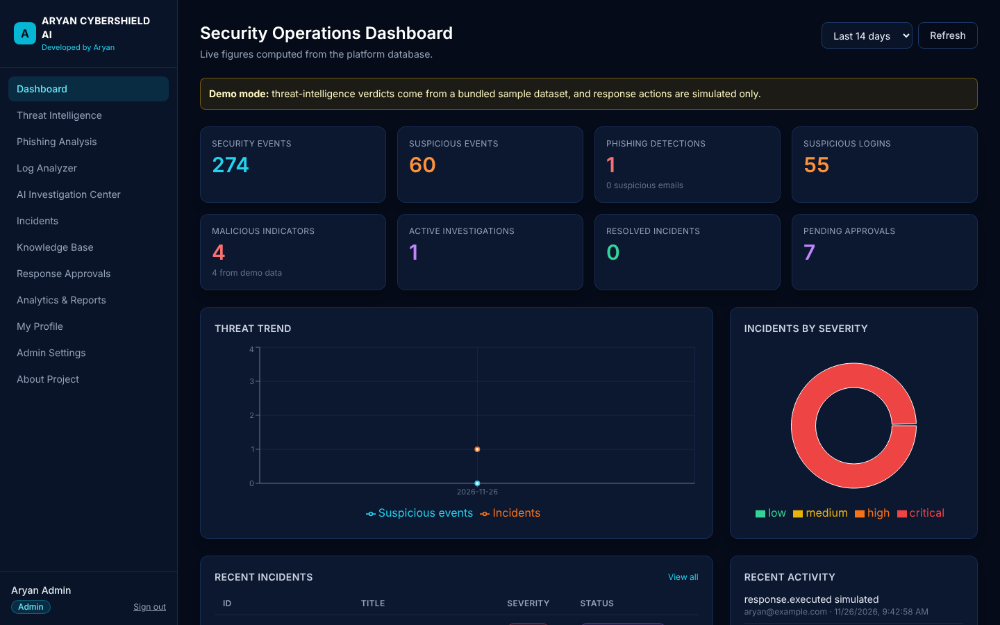

# ARYAN CYBERSHIELD AI

**Agentic AI-Based Cybersecurity Intelligence and Threat Investigation Platform**
**Project Developed By: Aryan**

An SOC-assistant web application: analyse suspicious emails, look up indicators, upload security logs, run a controlled multi-agent investigation, manage incidents, and approve (simulated) response actions - with every finding labelled as *verified fact* or *hypothesis*.



## What it does

| Area | Implementation |
|---|---|
| Auth & users | bcrypt, JWT with server-side revocation, admin / analyst roles, profile, admin user management |
| Dashboard | live counts, trend, severity and status charts computed from the database; empty/loading/error states |
| Phishing analysis | deterministic sender / language / URL checks + TF-IDF logistic-regression signal; evidence list, confidence, risk, next steps |
| Threat intelligence | IP / domain / URL / hash lookups; VirusTotal v3 (live) or labelled demo dataset; cache, source and timestamp on every result; failures reported as `unavailable` |
| Log analysis | CSV / JSON / text logs; rules (brute force, spraying, off-hours, new network, sensitive activity) + Isolation Forest signal |
| Multi-agent investigation | LangGraph: planner, phishing, log, threat-intel, investigation, risk, response agents; validated outputs, retries, tool allow-lists |
| Knowledge base (RAG) | PDF/TXT/MD/CSV/JSON upload, chunking, ChromaDB, cited retrieval, says so when nothing relevant exists; bundled MITRE ATT&CK summary + playbooks |
| Incidents | lifecycle with enforced transitions, history, assignment, resolution notes, CSV export |
| Response approvals | human approval, role-gated, **simulation only**, verification, rollback, audit |
| Reports | PDF and CSV per investigation, separating verified findings from hypotheses |

## Honest status

Read [documentation/LIMITATIONS.md](documentation/LIMITATIONS.md) before presenting or relying on this. In short:

* **No LLM is used.** Agents are deterministic. (The brief mentioned generative AI/LLMs; this is a documented gap, not hidden.)
* Models are trained on **synthetic** data; public datasets (CIC-IDS2017, UNSW-NB15...) were not used. No real-world accuracy claim is made.
* Response actions are **simulated**. Wazuh and pcap input are not implemented.
* Docker files are written and validated, but the images were **not built** in the development sandbox (no Docker daemon).

## Verified results (run during development)

| Check | Result |
|---|---|
| Backend tests (pytest, 56) | all pass on SQLite **and** on PostgreSQL 16, and in a clean virtualenv built from `requirements.in` |
| Frontend tests (Vitest, 24) | all pass |
| Browser end-to-end (Playwright/Chromium) | register, load knowledge, logs, phishing, intel, AI investigation, incident note, approval, dashboard, PDF download, logout, mobile width: pass, 0 console errors |
| Migration | upgrade / downgrade / upgrade on PostgreSQL 16; `alembic check`: no drift |
| Dependency audit | `npm audit`: 0 vulnerabilities; `pip-audit`: 5 chromadb findings (4 advisories), not reachable in this deployment (see LIMITATIONS D) |
| Performance | 100,000-event log analysis 4.4 s (was 29.4 s before a fix); full investigation ~0.23 s (see PERFORMANCE.md) |

## Quick start (local, demo mode, no paid APIs)

```bash
# 1. backend
cd backend
python3.13 -m venv .venv && source .venv/bin/activate     # Python 3.11+ works
pip install -r requirements.txt
export DATABASE_URL=sqlite:///./cybershield.db SECRET_KEY=$(python -c "import secrets;print(secrets.token_urlsafe(48))")
alembic upgrade head
uvicorn app.main:app --reload --port 8000

# 2. frontend (new terminal)
cd frontend && npm install && npm run dev      # http://localhost:5173
```

Open http://localhost:5173, **create the first account (it becomes the administrator)**, then follow [documentation/DEMO.md](documentation/DEMO.md). Full instructions (PostgreSQL, Docker, production, AWS, backup, troubleshooting): [documentation/INSTALLATION.md](documentation/INSTALLATION.md).

## Docker

```bash
cp .env.example .env     # set POSTGRES_PASSWORD and SECRET_KEY
docker compose up --build
# UI: http://localhost:8080
```

## Tests

```bash
cd backend && pytest -q                         # 56 tests
cd frontend && npm test                         # 24 tests
./scripts/run_e2e.sh                            # browser E2E (needs playwright + chromium)
python scripts/ml_report.py                     # regenerate documentation/ML_EVALUATION.md
python scripts/benchmark.py                     # timings
```

## Repository layout

```
backend/    FastAPI app (api, models, schemas, services, agents, ml, rag, security), migrations, tests
frontend/   React + Vite + Tailwind SPA
sample_data/  synthetic logs, demo threat intel, MITRE ATT&CK summary, IR playbooks, datasets
scripts/    sample-data generator, ATT&CK builder, benchmark, ML report, E2E runner
e2e/        Playwright browser test
documentation/  architecture, API, install, limitations, thesis, viva, screenshots
```

## Documentation

[Architecture](documentation/ARCHITECTURE.md) · [Installation](documentation/INSTALLATION.md) · [API](documentation/API.md) · [Features](documentation/FEATURES.md) · [Testing](documentation/TESTING.md) · [Performance](documentation/PERFORMANCE.md) · [ML evaluation](documentation/ML_EVALUATION.md) · [Limitations](documentation/LIMITATIONS.md) · [Demo](documentation/DEMO.md) · [Screenshots checklist](documentation/SCREENSHOTS_CHECKLIST.md) · [MCA thesis](documentation/MCA_THESIS.md) · [Viva Q&A](documentation/VIVA_QA.md) · [Resume text](documentation/RESUME_DESCRIPTION.md)

## Attribution & licence

Project Developed By: **Aryan**. Original project identity is established through authorship, documentation and implementation; no legal protection against copying is claimed. MITRE ATT&CK content is © The MITRE Corporation and used under its terms of use. Add a licence of your choice before publishing.
