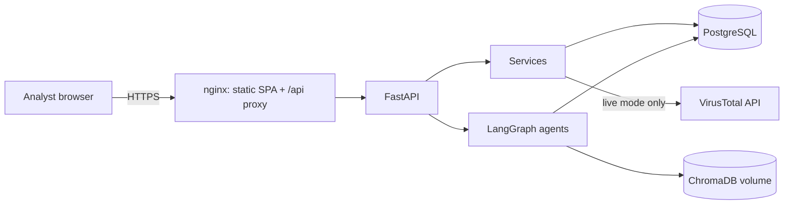
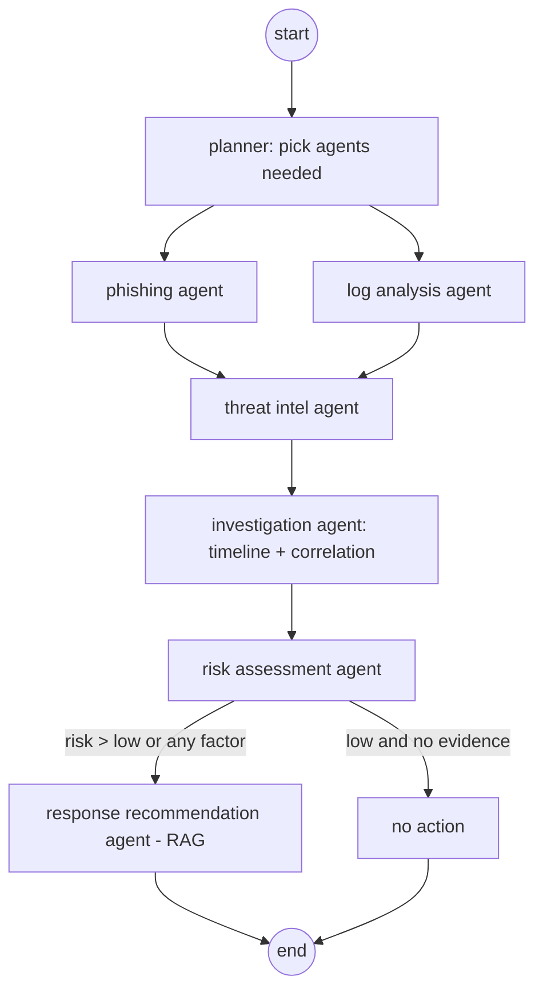

# ARYAN CYBERSHIELD AI - Architecture

**Project Developed By: Aryan** - Agentic AI-Based Cybersecurity Intelligence and Threat Investigation Platform.

This document describes what is **actually implemented**. Where the original brief asked for something that is not built, it is listed in [LIMITATIONS.md](LIMITATIONS.md).

## 1. Layers

| Layer | Technology | Responsibility |
|---|---|---|
| Frontend | React 18, Vite, Tailwind 3, Recharts, React Router 7 | 13 pages; talks only to the REST API |
| API | FastAPI, Pydantic v2 | validation, JWT auth, RBAC, rate limiting (auth endpoints), routing |
| Services | plain Python modules | log parsing, phishing, threat intel, approvals, reports, investigations |
| Agents | LangGraph `StateGraph` | controlled multi-agent investigation |
| ML | scikit-learn | TF-IDF + Logistic Regression (phishing text), Isolation Forest (logs) |
| RAG | ChromaDB (embedded) | ingestion, chunking, local hashing embeddings, retrieval, citations |
| Data | PostgreSQL 16 via SQLAlchemy 2 + Alembic | 13 relational tables; ChromaDB kept separate |

## 2. Demo mode vs. live mode

`DEMO_MODE=true` (default) needs no paid service:

* Threat intelligence reads a bundled **labelled demo dataset** (`sample_data/threat_intel_demo.json`, documentation-range IPs). Results carry `source: "demo-sample-data"` and the UI says so. An indicator absent from the dataset is `unknown`, never `clean`.
* With `DEMO_MODE=false` and `VIRUSTOTAL_API_KEY` set, VirusTotal v3 is queried. Any failure (missing key, 401/403, 429, network) yields `verdict: "unavailable"` with the reason - never a guessed value. Unavailable results are not cached and not scored.
* **No LLM is used anywhere.** All agents are deterministic functions; the verdict, severity and recommendations are computed from evidence. `rag.wrap_untrusted()` exists so a future LLM can be given retrieved text as inert quoted data.

## 3. Multi-agent design (`backend/app/agents/`)

* `phishing` and `log_analysis` are independent, so they fan out in parallel; `threat_intel` joins both (it needs the URLs/IPs they find).
* Only needed agents run: the planner inspects the request; an agent whose input is absent records `skipped` with a reason.
* Each agent returns a **Pydantic-validated** structure (`agents/schemas.py`). Invalid output is retried (max 2 attempts) then recorded as `failed`; one failed agent does not abort the others.
* **Tool allow-list** (`agents/tools.py`): each agent may call only named tools. `investigation` and `risk_assessment` have none. There is no shell, file-write or network-write tool, and every call (allowed or denied) is recorded in the report.
* **Risk score** (`risk_agent`) is a transparent sum of evidence factors (log alert severities, phishing class, malicious/suspicious indicators, corroboration), capped per source. Each factor is listed with its points. ML-only anomaly signals add **zero** points and appear only as hypotheses.
* **Facts vs. hypotheses:** observed findings go to `verified_findings`; inferences (e.g. "account may be compromised") go to `ai_hypotheses`. Reports and exports keep them apart. Evidence rows store `verified=true/false`.
* **Response agent** only *proposes* actions. They are stored as `PENDING` approval requests; the investigation itself never executes anything.

## 4. Human-approved response (`services/approvals.py`)

`PENDING -> approved | rejected`. On approval: target re-validated -> **simulated** execution -> verification record -> optional rollback (block/isolate only). Role matrix: analysts may decide `block_indicator`, `investigate_access`, `escalate_incident`; `reset_password`, `revoke_sessions`, `isolate_endpoint` need an admin. Every step is written to `audit_logs`. No external system is ever contacted.

## 5. Security controls implemented

bcrypt password hashing; JWT (HS256, 30 min) with server-side revocation (`token_version` bumped on logout/password change/role change); RBAC (`admin`, `analyst`); Pydantic input validation; upload type/size/content checks; CORS allow-list; rate limit on `/auth/register` and `/auth/login`; ORM-parametrised SQL; PDF output XML-escaped and CSV cells neutralised against formula injection; audit log; secrets only from environment (and never returned by `/admin/settings`); production mode hides `/docs` and refuses the default secret key; security headers + CSP in nginx; prompt-injection pattern flagging of knowledge chunks (flagged chunks are excluded from agent context); retrieved text can never alter tools or permissions because agents are code, not prompts.

## 6. Data model

`users, security_events, incidents, incident_history, threat_indicators, investigations, agent_runs, evidence, knowledge_documents, approval_requests, response_actions, audit_logs, ml_predictions`. Foreign keys, indexes on lookup columns, a CHECK constraint on `approval_requests.action_type`, unique constraints on indicators and document hashes, timestamps everywhere. Migration: `backend/migrations/versions/0001_initial_schema.py` (verified: upgrade, downgrade and re-upgrade on PostgreSQL 16; `alembic check` reports no model drift). See the ER diagram in [MCA_THESIS.md](MCA_THESIS.md#13-database-er-diagram).
