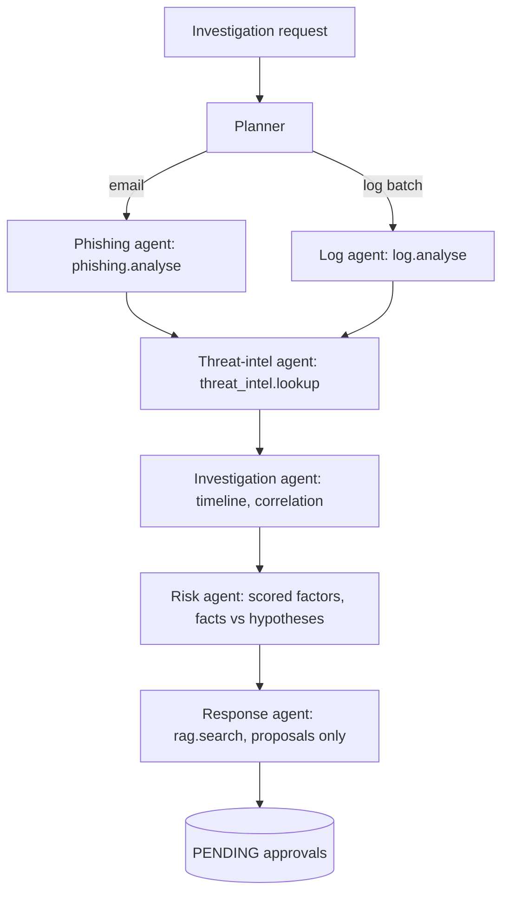
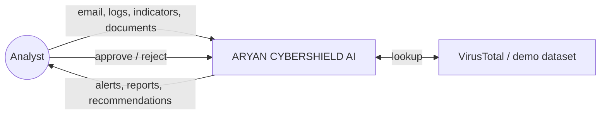
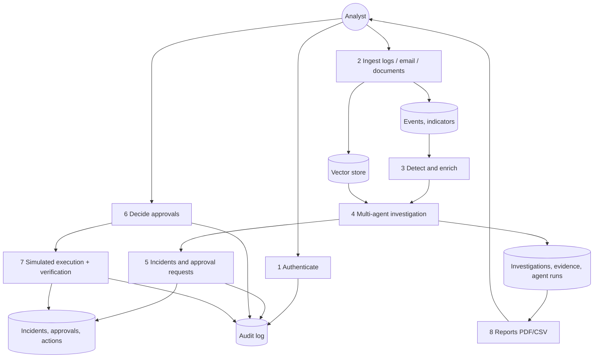
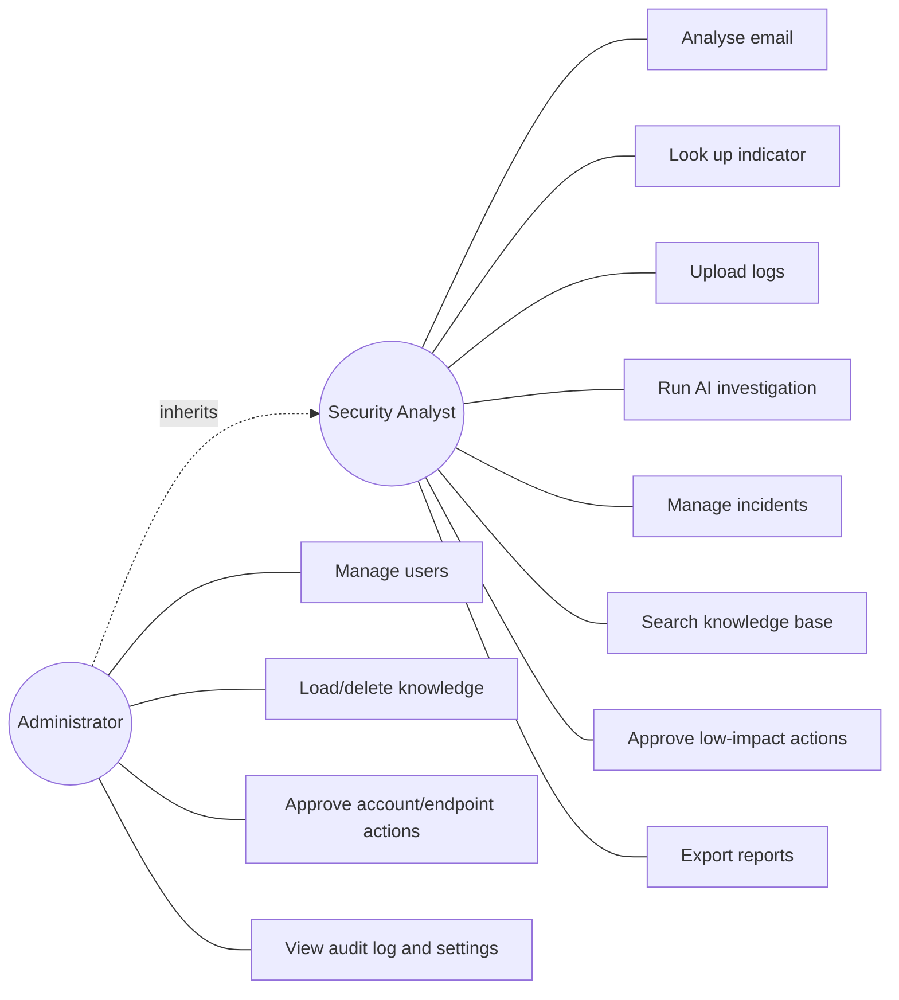
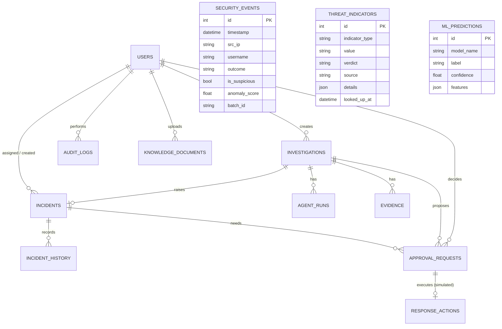

# ARYAN CYBERSHIELD AI: An Agentic AI-Based Cybersecurity Intelligence and Threat Investigation Platform

**Project Developed By: Aryan**

> Front-matter to be completed by Aryan (not invented here): University / Institute: `[...]` · Programme: MCA · Academic year: `[...]` · Supervisor / Guide: `[...]` · Enrolment number: `[...]` · Declaration, certificate, acknowledgements: `[...]`

## 1. Project Title
ARYAN CYBERSHIELD AI - Agentic AI-Based Cybersecurity Intelligence and Threat Investigation Platform.

## 2. Abstract
Security analysts must examine suspicious emails, authentication logs and reputation data from separate tools, then decide what to do. This project presents ARYAN CYBERSHIELD AI, a web platform that brings these tasks together. A FastAPI backend and React interface provide phishing analysis (deterministic checks plus a TF-IDF/logistic-regression signal), indicator lookups (VirusTotal or a labelled demo dataset), security-log analysis (rules plus an Isolation Forest), a ChromaDB-backed knowledge base with cited retrieval, incident management, and a LangGraph multi-agent investigation workflow. Seven cooperating components (planner, phishing, log analysis, threat intelligence, investigation, risk assessment, response recommendation) exchange validated, structured state; risk is computed from stated evidence and reports separate verified findings from hypotheses. Response actions are only proposed; they require human approval and are executed in simulation. The system was verified with 80 automated tests, a browser end-to-end test, PostgreSQL migration checks and dependency audits. Models were trained on small synthetic data, no large language model is used, and no real-world detection accuracy is claimed; limitations are documented.

**Keywords:** SOC automation, multi-agent systems, LangGraph, phishing detection, Isolation Forest, retrieval-augmented generation, human-in-the-loop response.

## 3. Introduction
Security Operations Centres face alert volumes that exceed manual capacity. Typical triage requires reading an email, checking domains in a reputation service, scanning logs for the same IP, consulting playbooks, and documenting the outcome. Automation can reduce this effort, but automated systems that act without evidence or oversight are risky. The project therefore emphasises transparency (every score is traceable), honesty about uncertainty (unknown is not clean; unavailable is not guessed) and human control over consequential actions.

## 4. Problem Statement
Build an integrated platform that (a) detects suspicious activity in emails and logs, (b) enriches indicators with threat intelligence, (c) correlates evidence into an investigation with a timeline and risk assessment, (d) retrieves relevant procedures with citations, and (e) lets authorised humans approve response actions, while preserving an audit trail - and does so without overstating its accuracy or autonomy.

## 5. Objectives
1. Secure multi-user access with role-based control and auditing.
2. Phishing analysis combining observable indicators with a learned signal.
3. Indicator investigation with source attribution, timestamps, caching and failure handling.
4. Log parsing, normalisation and detection of brute force, spraying and unusual access.
5. A controlled multi-agent workflow with validated outputs, retries and tool restrictions.
6. A RAG knowledge base that cites sources and admits when it has no answer.
7. Incident lifecycle management and a human-approved, simulated response workflow.
8. Exportable reports distinguishing facts from hypotheses.
9. A reproducible, tested, containerised delivery with a no-paid-API demo mode.

## 6. Existing System
Organisations commonly use separate tools: email gateways, SIEMs (e.g. Wazuh/Splunk), standalone reputation portals (e.g. VirusTotal), ticketing systems and wikis. Correlation across them is manual. Commercial SOAR platforms automate this but are costly and complex. Recent "AI SOC" tools frequently rely on opaque LLM outputs. Drawbacks: context switching, slow triage, inconsistent documentation, and in AI-driven tools, weak traceability and risk of unsafe autonomous action.

## 7. Proposed System
A single application with: deterministic, explainable detectors; ML as a bounded supporting signal; a graph-orchestrated set of agents with explicit responsibilities; evidence-based risk scoring; retrieval of cited guidance; and a human approval gate with simulated execution, verification, rollback and audit. See [ARCHITECTURE.md](ARCHITECTURE.md).

## 8. Literature and Technology Review
* **MITRE ATT&CK** is a knowledge base of adversary tactics and techniques; the platform maps alerts to technique IDs (e.g. T1110 Brute Force, T1566 Phishing) and includes a summary of 700+ techniques for retrieval.
* **NIST SP 800-61 Rev. 2** frames incident handling (preparation, detection and analysis, containment/eradication/recovery, post-incident), reflected in the incident lifecycle and playbooks.
* **Isolation Forest** (Liu, Ting, Zhou, 2008) isolates anomalies by random partitioning; it is unsupervised and fast, making it suitable when labels are unavailable.
* **TF-IDF with logistic regression** is a standard, interpretable text classification baseline (scikit-learn, Pedregosa et al., 2011).
* **Retrieval-Augmented Generation** (Lewis et al., 2020) grounds outputs in retrieved documents; this project uses the retrieval half with citations.
* **Indirect prompt injection** (Greshake et al., 2023) and the **OWASP Top 10 for LLM Applications** motivate treating retrieved/uploaded text as untrusted.
* **Datasets** commonly used in the field include CIC-IDS2017 (Sharafaldin et al., 2018) and UNSW-NB15 (Moustafa and Slay, 2015); they were *not* used here (see section 16).
* **Frameworks:** FastAPI + Pydantic (typed APIs), SQLAlchemy/Alembic (ORM, migrations), PostgreSQL, ChromaDB (embedded vector store), LangGraph (stateful agent graphs), React/Vite/Tailwind/Recharts, JWT (RFC 7519), bcrypt.

## 9. System Architecture
Layered: React SPA -> nginx -> FastAPI -> services/agents -> PostgreSQL and ChromaDB; optional VirusTotal. Diagram and component table: [ARCHITECTURE.md](ARCHITECTURE.md#1-layers).

## 10. Agent Architecture

Orchestrator responsibilities and where they live: receiving requests (`api/investigations.py`), choosing agents (`plan_agent`), execution order and parallelism (graph edges), shared structured state (`State` TypedDict), failures and retries (`_run`, 2 attempts, isolation), context and final report (`services/investigations.py`). Agents without tools (investigation, risk) cannot touch external systems. Details and rules: [ARCHITECTURE.md](ARCHITECTURE.md#3-multi-agent-design-backendappagents).

## 11. Data Flow Diagrams
**Level 0**

**Level 1**

## 12. Use-Case Diagram

## 13. Database ER Diagram

(`SECURITY_EVENTS`, `THREAT_INDICATORS`, `ML_PREDICTIONS` are standalone record tables linked logically by IP/batch.)

## 14. Implementation Details
Backend modules: `api/` (7 routers), `models/entities.py` (13 tables), `schemas/`, `services/` (log_parser, logs, phishing, threat_intel, approvals, investigations, reports), `agents/` (orchestrator, tools, schemas), `ml/` (phishing_model, log_analysis), `rag/store.py`, `security/auth.py`. Frontend: 13 pages, shared UI kit, `useAsync` hook for loading/error/empty states, auth context with protected routes. Background execution of investigations uses FastAPI `BackgroundTasks` with a separate DB session; the UI polls until completion. Delivery: Dockerfiles, nginx with CSP, Compose with PostgreSQL, health checks, Alembic migrations on start.

## 15. Algorithms and Methodologies
**Phishing score:** `score = min(100, sum(indicator points) + round(P_ml x 25))`; class = *phishing* if score >= 60 and >= 2 significant indicators; *suspicious* if score >= 30; else *legitimate*. Indicators include look-alike detection (leetspeak normalisation, `rn`->`m`, brand embedding), URL structure checks and language patterns.

**Brute force:** sliding 10-minute window of failed logins per source IP, threshold 10; escalated to critical when a success from the same IP follows within 30 minutes. **Spraying:** >= 5 distinct usernames failing from one IP.

**Isolation Forest:** features per (IP, 10-minute window): events, failures, distinct users, off-hours share, failure ratio; 200 trees, seed 42, contamination 0.05; flagged windows reported as low-severity unconfirmed signals; one alert per IP.

**Risk score:** sum of capped evidence factors: log alerts (critical 40, high 25, medium 10, low 3; cap 60), phishing (20 + 0.2 x risk, cap 40; suspicious 10), malicious indicators (20 each, cap 40) and suspicious (8 each, cap 16), corroborated malicious indicator (+10); levels: >= 75 critical, >= 50 high, >= 25 medium, else low. ML-only signals add 0.

**RAG:** paragraph-aware chunking (900 chars, 150 overlap) -> hashing n-gram embedding (2048 dims, L2) -> cosine search; results below similarity 0.12 are dropped; chunks matching injection patterns are flagged and excluded from agent context.

## 16. Dataset Descriptions
| Dataset | Origin | Use |
|---|---|---|
| `phishing_synthetic.csv` | template-generated by `scripts/generate_sample_data.py` (600 rows, 314 distinct after de-duplication, balanced) | training the phishing text model |
| `phishing_eval_handwritten.json` | 16 emails written by the project author (8 phishing, 8 legitimate incl. urgent-but-benign traps), never used for training | evaluation |
| `auth_logs.csv/json/txt` | synthetic: ~220 normal events + 3 injected scenarios (brute force with success, spraying, off-hours privileged activity); TEST-NET documentation IPs | demo and functional checks |
| `threat_intel_demo.json` | 5 fabricated demo records | demo mode |
| MITRE ATT&CK enterprise | github.com/mitre/cti STIX, summarised (techniques, tactics, truncated descriptions) | RAG corpus |
| Incident-response playbooks | written for this project | RAG corpus |

CIC-IDS2017, UNSW-NB15, the UCI/Phishing Websites dataset and BETH were **not** used: downloads were not available in the build environment, and flow-based network datasets do not share a schema with authentication logs. Incompatible datasets were deliberately not combined.

## 17. Experimental Results
All values are produced by `scripts/ml_report.py` ([ML_EVALUATION.md](ML_EVALUATION.md)).

| Evaluation | n | Acc | Prec | Recall | F1 | FPR |
|---|---|---|---|---|---|---|
| Phishing text model, synthetic held-out (75/25, seed 42) | 79 | 1.000 | 1.000 | 1.000 | 1.000 | 0.000 |
| Phishing text model, hand-written | 16 | 0.8125 | 0.7778 | 0.875 | 0.8235 | 0.25 |
| Full analyser (body text only, suspicious = flagged), hand-written | 16 | 0.8125 | 1.000 | 0.625 | 0.769 | 0.000 |

(The last row's precision, recall and F1 follow from TP 5, FP 0, TN 8, FN 3.)

*Interpretation:* the synthetic score reflects shared templates, not real performance; the hand-written set is small and exposes errors (a benign "urgent" maintenance notice and a security notice flagged by the text model alone; three credential/payment phishing texts missed by the full analyser when no sender or URL is supplied). With sender and URL data present, deterministic indicators fire (sample phishing email: look-alike domain, urgency, credential request, URL structure -> classified *phishing*). Thresholds were not tuned on the 16 samples.

*Log detection (synthetic, 274 events):* all 3 injected scenarios detected by rules; 0 false brute-force/spraying alerts on normal internal traffic; Isolation Forest flagged 10 of 216 windows (5% by construction). This is a functional check; the scenarios were authored with the rules, so it is not an accuracy benchmark.

*Performance:* see [PERFORMANCE.md](PERFORMANCE.md) (100,000 events in 4.4 s after optimisation; a full investigation in about 0.23 s).

## 18. Testing
56 backend tests (authentication, authorisation, database/PostgreSQL, file upload, API, agent workflow, threat analysis, RAG retrieval, prompt-injection, retry/failure, false-positive traps, end-to-end), 24 frontend tests (validation, auth flow, API integration, loading/error states), 1 Playwright browser flow; all executed and passing. Seven defects discovered by testing and fixed are listed in [TESTING.md](TESTING.md). Not tested: Docker image build, AWS, live VirusTotal, load, penetration.

## 19. Limitations
Summarised: no LLM; synthetic training data and no public-dataset evaluation; simulation-only response; no Wazuh/pcap; lexical retrieval; Docker unverified by build; token in sessionStorage; per-process rate limits; 5 unreachable chromadb server findings; in-process background tasks. Full list: [LIMITATIONS.md](LIMITATIONS.md).

## 20. Future Scope
LLM-generated narrative summaries behind the existing validation layer; training and cross-dataset evaluation on CIC-IDS2017/UNSW-NB15 with leakage controls; neural embeddings and re-ranking; Wazuh and pcap ingestion; real response connectors (firewall, IdP, EDR) with approvals unchanged; asynchronous ingestion queue and workers; HttpOnly-cookie sessions, MFA, lockout; SIEM export, notifications; analyst-feedback loop for model retraining.

## 21. Conclusion
The project demonstrates that an investigation assistant can be useful while remaining transparent and controllable: deterministic evidence drives severity, ML is a bounded signal, agents are constrained, uncertainty is displayed, and humans approve consequential actions. It is a working, tested prototype of a platform, not a production SOC product, and its evaluation is honest about being small and synthetic.

## 22. References
*(Verify each entry's exact details against the original source before submission.)*
1. MITRE. *MITRE ATT&CK.* https://attack.mitre.org ; STIX data: https://github.com/mitre/cti
2. P. Cichonski, T. Millar, T. Grance, K. Scarfone. *Computer Security Incident Handling Guide*, NIST SP 800-61 Rev. 2, 2012.
3. F. T. Liu, K. M. Ting, Z.-H. Zhou. "Isolation Forest." IEEE ICDM, 2008.
4. F. Pedregosa et al. "Scikit-learn: Machine Learning in Python." JMLR 12, 2011.
5. P. Lewis et al. "Retrieval-Augmented Generation for Knowledge-Intensive NLP Tasks." NeurIPS, 2020.
6. K. Greshake et al. "Not what you've signed up for: Compromising Real-World LLM-Integrated Applications with Indirect Prompt Injection." 2023.
7. OWASP. *OWASP Top 10 for Large Language Model Applications.* https://owasp.org
8. I. Sharafaldin, A. H. Lashkari, A. A. Ghorbani. "Toward Generating a New Intrusion Detection Dataset and Intrusion Traffic Characterization (CIC-IDS2017)." ICISSP, 2018.
9. N. Moustafa, J. Slay. "UNSW-NB15: a comprehensive data set for network intrusion detection systems." MilCIS, 2015.
10. M. Jones, J. Bradley, N. Sakimura. *JSON Web Token (JWT)*, RFC 7519, 2015.
11. FastAPI, Pydantic, SQLAlchemy, Alembic, ChromaDB, LangGraph, React, Vite, Tailwind CSS, Recharts: official documentation.
12. VirusTotal. *VirusTotal API v3 documentation.* https://docs.virustotal.com
